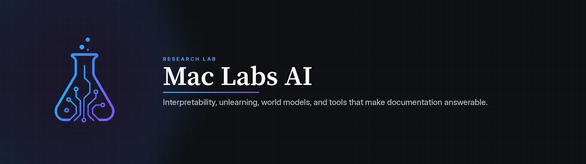

  

Mac Labs AI is the research lab of [Mackenzie O'Brien](https://github.com/mso-docs). We study how language models represent, suppress, and act on knowledge, and we build tools that make documentation answerable, with a longer project list on the [portfolio](https://mso-docs.github.io/mac-portfolio/).

## Research

**Unlearning vs. Hiding** (Lexsi AI Safety and Alignment Hackathon, Track 2b) is an audit of Representation Misdirection for Unlearning (RMU) on Tiny Aya (3.35B). RMU suppresses the injected facts at the output, but this audit does not claim erasure ([site](https://mso-docs.github.io/Lexsi-Unlearning/), [paper](https://mso-docs.github.io/Lexsi-Unlearning/downloads/Lexsi-Unlearning-paper.pdf), [code](https://github.com/mso-docs/Lexsi-Unlearning), [video](https://youtu.be/BuCfLNA-gfc)).

**A Linear Answerability Signal That the Model Does Not Act On** (independent entry, AI x Epistemics Research Sprint). A linear probe finds a signal for answerability in Phi-3.5-mini's hidden states that the model's output does not follow. Probe area under the receiver operating characteristic curve (AUROC) at layer 18 on SQuAD 2.0 is 0.906 (95% confidence interval 0.867 to 0.948) ([site](https://mso-docs.github.io/Apart-Epistemics/), [paper](https://mso-docs.github.io/Apart-Epistemics/downloads/Apart-Epistemics-paper.pdf), [code](https://github.com/mso-docs/Apart-Epistemics), [video](https://youtu.be/og3AKyBByQw)).

**Moral Shadowbanning** (research participant, [SPAR Fall 2026](https://sparai.org/projects/f26/reckqc5o81AtSxOFU/)). This project asks whether conversational models become less helpful, honest, or harmless toward users they judge to have poor moral character. Paper and code are forthcoming.

**JEPA-style world models** (research collaboration, in progress). We are researching Joint Embedding Predictive Architecture (JEPA) world models for time-series event forecasting, including how event-probability forecasts should be calibrated when event rates change, and building on [KITE](https://arxiv.org/abs/2610.12738).

## Tools

**DocsNavigator MCP** is a Model Context Protocol (MCP) server with a Gradio app that answers questions over documentation files, using full-text search, a language model, and optical character recognition (OCR) for scanned PDFs and images ([project page](https://mso-docs.github.io/Docs-Navigator/), [Space](https://huggingface.co/spaces/mackenzietechdocs/DocsNavigatorMCP), [code](https://github.com/mso-docs/Docs-Navigator)).

**Docs Navigator MCP: SUSE Edition**, built for SUSE Hack Week 25, searches SUSE, Rancher, K3s, and RKE2 documentation with local open-source models and answers questions about them. It is an independent project, not an official SUSE product ([project page](https://mso-docs.github.io/Docs-Navigator-MCP-SUSE-Edition/), [Space](https://huggingface.co/spaces/mackenzietechdocs/DocsNavigatorMCP-SUSE), [code](https://github.com/mso-docs/Docs-Navigator-MCP-SUSE-Edition)).

**HealixPath**, built for the Hugging Face MCP 1st Birthday with [DevRubenArevalo](https://github.com/DevRubenArevalo), is an MCP health assistant that runs on free open models ([project page](https://mso-docs.github.io/HealixPath/), [Space](https://huggingface.co/spaces/mackenzietechdocs/HealixPath), [code](https://github.com/mso-docs/HealixPath)).

Seventeen public [hackathon projects](https://mso-docs.github.io/mac-portfolio/hackathons/) have shipped since August 2025.

We also keep internal dev tooling for local research workflows and GPU fleet monitoring. Those repositories stay private.

## People

Mackenzie O'Brien leads the lab. [Ruben Arevalo](https://github.com/DevRubenArevalo) collaborates on tools work, including HealixPath.

## Links

[Portfolio](https://mso-docs.github.io/mac-portfolio/) · [Mackenzie on GitHub](https://github.com/mso-docs) · [Hugging Face](https://huggingface.co/mackenzietechdocs) · [LinkedIn](https://www.linkedin.com/in/mackenzieoc)
